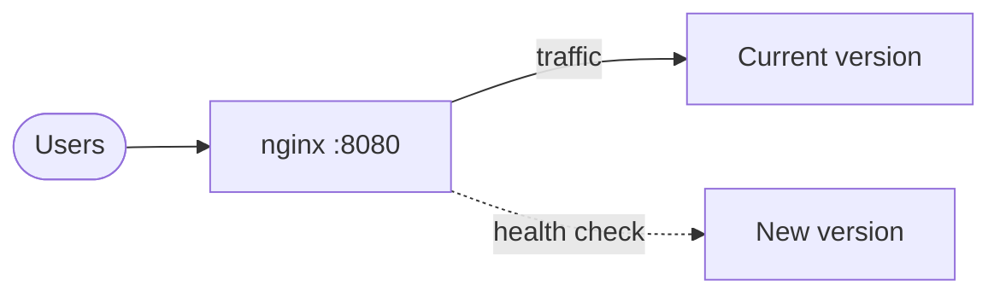

# Release Coordinator

Deploy new versions of a web app with **zero downtime**. If the new version is unhealthy, it **rolls back automatically**.

- **`app/`**: a small web service with `/version` and `/health`
- **`nginx`**: the public entry point at <http://localhost:8080>
- **`deploy.py`**: the deploy tool

## How it works



1. `deploy.py` starts the **new version** next to the current one.
2. It checks the new version's `/health`.
3. **Healthy:** nginx switches traffic to the new version and the old one is removed.
4. **Unhealthy:** the new version is removed and traffic never moves.

Users never see an error during the switch.

## Implementation notes

### Proxy and routing: nginx with a generated upstream file

**nginx** (run by Docker Compose) is the single public entry point on `:8080`. The app containers publish no ports; nginx reaches them by container name on a shared Docker network. So two versions can run side by side without a port conflict.

Which container gets traffic is set by one small generated file, `nginx/upstream/active.conf`, which nginx includes. It starts as a copy of [active.placeholder.conf](nginx/upstream/active.placeholder.conf) and after a deploy looks like:

```nginx
upstream web_backend {
    server rc-web-v2.0.0-a1b2c3:8000;
}
```

To switch versions, `deploy.py` rewrites this file and runs `nginx -s reload`.

**Why nginx rather than Traefik or HAProxy:** it's the most widely known proxy, and its graceful reload gives zero-downtime switching out of the box. The switch is also an ordinary config change you can read, with no extra API or service-discovery setup. Traefik would switch automatically from container labels, but it would then decide *when* traffic moves. Here `deploy.py` decides, only after the new version is proven healthy.

### State: one file is the source of truth

- **What's live:** `active.conf` itself. Its comment header records the live container and version (`# active_version=v2.0.0`), and `deploy.py` reads that back. So the file that routes traffic and the tool's record can never disagree. It survives restarts of nginx, of the tool and of the machine, and needs no database.
- **Which containers are ours:** every app container carries the label `rc.managed=true` (plus `rc.version`). The tool never touches anything else.
- **Safe writes:** the file is written to a temporary file and renamed into place, so nginx never reads half a file. A lock file stops two deploys from running at once.
- **Self-repair:** each deploy starts by reloading nginx from the file and removing any of our containers that aren't live. This fixes anything a killed (`kill -9`) deploy left behind.

### Preventing downtime during transitions

1. **Side by side:** the new version starts next to the old one, which keeps serving all traffic.
2. **Health gate:** traffic moves only after `/health` returns `200` **3 times in a row**. The check runs from inside the nginx container, the same network path users' traffic will take.
3. **Checked config:** `nginx -t` validates the new file before it's applied, so a broken config never goes live.
4. **Graceful reload:** `nginx -s reload` starts new workers on the new version, while the old workers finish their in-flight requests first. No connection is dropped.
5. **Name lookup during the reload:** nginx finds the new container's address during the reload, before any new request arrives. An earlier version looked it up just *after* the reload and dropped about 1 in 22,000 requests; the stress test now guards against that.
6. **Verify, then drain:** the tool confirms the public URL shows the new version, then waits a few seconds before stopping the old container (SIGTERM, so it finishes its last requests).
7. **Automatic rollback:** any failure, Ctrl-C or `kill` before step 6 completes puts the previous file back and removes the new container.

**Evidence:** [scripts/stress_test.py](scripts/stress_test.py) runs 22 deploys, rollbacks and kills under constant traffic. Result: 85,768 requests, **0 errors**.

## Quick start

You need Docker (or Podman) and Python 3.10+.

```bash
python3 -m venv .venv && source .venv/bin/activate
pip install -r requirements.txt

python deploy.py --deploy v1.0.0     # first version
python deploy.py --deploy v1.3.0     # upgrade, zero downtime
python deploy.py --status            # what's live?
```

Open <http://localhost:8080/version> (blue page) or <http://localhost:8080/health> (green page).

### Try a failed deploy

```bash
python deploy.py --deploy v3.0.0 --fail-healthcheck --timeout 10
```

The new version reports unhealthy, so it is removed, the tool exits with code `1`, and v2.0.0 keeps serving.

### Run without deploy.py

```bash
docker-compose --profile standalone up -d --build
```

This runs one fixed version with no deploy tool. If you later run `deploy.py`, it takes over and removes the standalone container.

## Endpoints

| URL | What it returns | Try it |
| --- | --- | --- |
| `/version` | The version, e.g. `{"version": "v2.0.0"}` | `curl localhost:8080/version` |
| `/health` | `200` when healthy, `500` when unhealthy | `curl -i localhost:8080/health` |
| `/app` | Redirects to `/health` | `curl -L localhost:8080/app` |
| `POST /admin/health` | `{"fail": true}` makes `/health` return `500`; `{"fail": false}` makes it healthy again | see below |

Browsers see colored pages: `/version` is **blue**, `/health` is **green** (or **red** when unhealthy). curl and scripts get JSON.

### Testing each endpoint with curl

`-i` shows the HTTP status line (`200 OK`, `500 ...`) above the body.

**`/version`**: which version is live

```bash
curl localhost:8080/version
# {"version":"v1.3.0"}
```

**`/health`**: is the live version healthy?

```bash
curl -i localhost:8080/health
# HTTP/1.1 200 OK
# ...
# {"status":"ok","version":"v1.3.0"}

# Just the status code:
curl -s -o /dev/null -w '%{http_code}\n' localhost:8080/health
# 200
```

**`/app`**: redirects to `/health`

```bash
curl -i localhost:8080/app     # shows the redirect itself
# HTTP/1.1 302 Found
# location: /health

curl -L localhost:8080/app     # -L follows it
# {"status":"ok","version":"v1.3.0"}
```

**`POST /admin/health`**: simulate a failure, then recover

```bash
# 1. Make /health fail
curl -X POST localhost:8080/admin/health -H 'Content-Type: application/json' -d '{"fail": true}'
# {"fail_healthcheck":true}

# 2. Check it: now 500
curl -i localhost:8080/health
# HTTP/1.1 500 Internal Server Error
# ...
# {"status":"unhealthy","reason":"FAIL_HEALTHCHECK enabled","version":"v1.3.0"}

# 3. Make it healthy again (don't forget this step!)
curl -X POST localhost:8080/admin/health -H 'Content-Type: application/json' -d '{"fail": false}'
# {"fail_healthcheck":false}
```

This only affects the version that's live now; a new deploy starts healthy. Leaving it failing doesn't take the site down (users still get `/version`), but the health check reports 500 until you turn it off.

**Browser view**: ask for HTML, as a browser does, to get the colored page

```bash
curl -H 'Accept: text/html' localhost:8080/version
```

## deploy.py options

| Option | Default | What it does |
| --- | --- | --- |
| `--deploy TAG` | | Version to deploy |
| `--status` | | Show what's live |
| `--timeout` | `30` | Seconds to wait for the new version to be healthy |
| `--healthy-checks` | `3` | Health checks that must pass **in a row** before switching traffic |
| `--keep-images` | `3` | After a successful deploy, keep only this many newest images (`0` = keep all) |
| `--fail-healthcheck` | off | Make the new version unhealthy, to test rollback |
| `--build` | off | Rebuild the image after changing app code |

Run `python deploy.py --help` for all options.

### Old images are deleted automatically

After every **successful** deploy, `deploy.py` keeps only the **3 newest** app images and deletes the older ones, so they don't fill up your disk. The image of the version that's live is never deleted.

- **Keep more:** `python deploy.py --deploy v2.0.0 --keep-images 10`
- **Turn it off:** `python deploy.py --deploy v2.0.0 --keep-images 0`
- **Deploying a tag whose image was deleted** still works, but the image is rebuilt from the **current** app code, not the code that tag originally had.
- **See which images you have:** `docker images release-coordinator/web`

**Exit codes:** `0` success · `1` failed and rolled back · `2` couldn't start (nothing changed)

## What happens if...

| Situation | What deploy.py does |
| --- | --- |
| The new version never becomes healthy | Gives up after `--timeout`, rolls back, exits `1` |
| The new version is flaky | It must pass 3 health checks **in a row**; one failure resets the count |
| You press Ctrl-C, or it gets `kill`ed (e.g. a cancelled CI job) | Rolls back, exits `1` |
| It gets `kill -9`ed, or the machine loses power mid-deploy | Nothing can run at that moment, so the **next** deploy fixes it: it re-syncs nginx and removes leftover containers |
| Port 8080 is used by another program | Stops with a clear message suggesting `NGINX_PORT=9090`, exits `2` |
| Two deploys at once | The second one exits `2` |
| Old images pile up | Only the newest 3 are kept (`--keep-images`) |

Users keep being served by the old version in every one of these cases.

## Testing

### Stress test (zero downtime, proven)

```bash
python scripts/stress_test.py
```

This sends nonstop traffic to the app while it runs, three times over:

1. a normal deploy (must succeed)
2. a deploy whose health check fails (must roll back)
3. a deploy that crashes **after** traffic has switched (must switch traffic back)
4. a deploy that gets `kill`ed (must roll back)
5. a deploy that gets `kill -9`ed (can't clean up, so it leaves a container behind...)
6. ...which the next deploy must remove
7. another normal deploy

After each one it checks the exit code, which version is live, and that no leftover containers remain. It prints **PASS** only if everything behaved **and not one user request failed**. Afterwards it restores whatever version was live before. Options: `--rounds 5`, `--concurrency 16`, and `-v` to see `deploy.py`'s logs.

```text
Scenarios: 22/22 passed
Traffic:   85,768 requests, 0 errors, 15 version switches seen by users
RESULT:    PASS
```

### Code checks

```bash
pip install -r requirements-dev.txt
ruff check . && ruff format --check . && mypy
```

These run the linter, formatter and type checker; their settings are in `pyproject.toml`.

## Troubleshooting

| Problem | Fix |
| --- | --- |
| `docker compose` says `unknown shorthand flag: 'd'` | Use `docker-compose` (with a hyphen) instead |
| `502 Bad Gateway` | Nothing is deployed yet. Run `python deploy.py --deploy v1.0.0` |
| Browser shows "Not Found" | Use a real path, like `/version` or `/health` |
| No colored pages, or `/app` is missing | That version's image is older than the app code. Add `--build` to the deploy command |
| Port 8080 is in use | Run with `NGINX_PORT=9090` in front of the command |
| Start completely over | `docker rm -f $(docker ps -aq --filter label=rc.managed=true); docker-compose --profile standalone down; rm nginx/upstream/active.conf` |

## Project files

| Path | Purpose |
| --- | --- |
| `app/` | Web service and its Dockerfile |
| `deploy.py` | Starts the deploy tool (a few lines) |
| `release_coordinator/` | The deploy tool's code, one small file per job. Start with `__init__.py` (big picture, edge cases), then `deployer.py` (the 7 steps in order) |
| `docker-compose.yml` | Runs nginx (and the optional standalone app) |
| `nginx/upstream/active.conf` | Which version is live. Generated: not in git, created from `active.placeholder.conf` on first start, then updated by every deploy |
| `nginx/init/` | Startup script that creates `active.conf` if it's missing |
| `scripts/traffic_check.py` | Sends traffic during a deploy to prove nothing fails |
| `scripts/stress_test.py` | Repeated deploys, rollbacks and kills under traffic, with PASS/FAIL |
| `pyproject.toml`, `requirements-dev.txt` | Settings and tools for the code checks |
